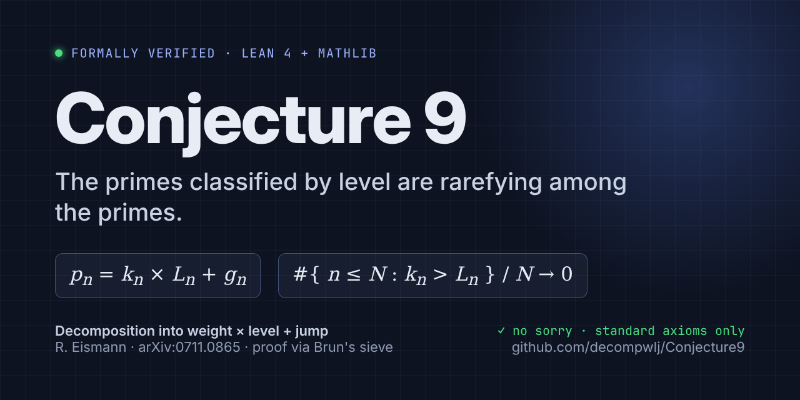

<p align="center">
  
</p>

# Conjecture 9, formally proved in Lean 4

[](https://github.com/decompwlj/Conjecture9inLEAN/actions/workflows/lean.yml?query=branch%3Amain)
[](https://lean-lang.org)
[](https://github.com/leanprover-community/mathlib4)
[](https://arxiv.org/abs/0711.0865)

> **Conjecture 9.** The prime numbers classified by level are rarefying among the primes.
>
> From R. Eismann, *Decomposition into weight × level + jump and application to a new
> classification of primes*, [arXiv:0711.0865](https://arxiv.org/abs/0711.0865).

This repository contains a **complete, machine-checked proof** of Conjecture 9 in
[Lean 4](https://lean-lang.org) with [Mathlib](https://github.com/leanprover-community/mathlib4).
It has no `sorry` and no extra axioms, and GitHub Actions re-checks it on every push.

🌐 **Atlas:** [decompwlj.net](https://decompwlj.net) — 5000 OEIS integer sequences decomposed into
weight × level + jump with interactive 3D/2D three.js graphs.

## In one minute

Every prime `p_n` except 2, 3 and 7 can be written as (Theorem 3.1 of the paper)

```
p_n = k_n × L_n + g_n
```

where

* `g_n = p_{n+1} − p_n` is the **jump** (the prime gap),
* `k_n`, the **weight**, is the smallest divisor of `p_n − g_n` that is larger than `g_n`,
* `L_n = (p_n − g_n) / k_n` is the **level**.

This is the Euclidean division of `p_n` by `k_n`: the quotient is `L_n` and the remainder is
`g_n`. The prime `p_n` is **classified by level** when `k_n > L_n`, and **by weight** otherwise.
Examples: `5, 13, 19, 23, 31, 37, 43, 47, 53` are classified by level. Among the first `5·10⁷`
primes, 17.11 % are classified by level.

**Conjecture 9** says this proportion tends to `0`. In Lean:

```lean
def Conjecture9 : Prop :=
  Tendsto (fun N : ℕ => (#{n < N | P n is classified by level} : ℝ) / N) atTop (𝓝 0)

theorem conjecture9 : Conjecture9
```

**Idea of the proof.** If `p_n` is classified by level, then `p_n − g_n = s·q` with `q` prime and
`s ≤ g_n`. So `q`, `sq + g_n` and `sq + 2g_n` (that is, `p_n` and `p_{n+1}`) are three primes at
once. Brun's sieve shows that such prime triples are rare, and the proportion goes to 0
(roughly like `log log x / log x`, which explains why it is still 17 % at `5·10⁷`).

## What is proved

| Result | Lean name | Status |
|---|---|---|
| Definitions of jump `d_n`, `l_n`, weight `k_n`, level `L_n`, "classified by level" | `WLJ.jump`, `WLJ.lval`, `WLJ.weight`, `WLJ.level`, `WLJ.ClassifiedByLevel` | ✅ |
| Lemma 1.1: the decomposition exists iff `a_{n+1} < (3/2) a_n` | `WLJ.lemma_1_1` | ✅ proved |
| `a_n = k_n × L_n + d_n` with `d_n < k_n` (Euclidean division) | `WLJ.decomposition` | ✅ proved |
| **Existence**: a decomposition `a_n = k·L + d_n` with `d_n < k`, `L ≥ 1` exists iff `l_n ≠ 0` | `WLJ.exists_decomposition_iff` | ✅ proved |
| **Uniqueness**: `(k_n, L_n)` is the unique pair with `a_n = k·L + d_n`, `d_n < k` and `k` minimal | `WLJ.decomposition_unique` | ✅ proved |
| Euclidean division: `a_n / k_n = L_n`, `a_n mod k_n = d_n`, and `k_n = min {k > d_n : a_n mod k = d_n}` | `WLJ.div_weight_eq_level`, `WLJ.mod_weight_eq_jump`, `WLJ.isLeast_weight` | ✅ proved |
| Table 2 of the paper (first 17 primes) is reproduced | `WLJ.Table2.*` | ✅ checked by the kernel |
| **Structural lemma**: if `p_n` is classified by level and `g_n⁴ ≤ l_n`, then `l_n = s·q` with `q` prime and `s ≤ g_n` | `WLJ.lval_eq_mul_prime_of_classifiedByLevel` | ✅ proved |
| Counting bound (below) | `WLJ.levelCount_le` | ✅ proved |
| Reduction of Conjecture 9 to a sieve bound for prime triples | `WLJ.conjecture9_of_sieve : TripleSieveBound → Conjecture9` | ✅ proved |
| The sieve bound `TripleSieveBound` (Brun's pure sieve) | `WLJ.Sieve.tripleSieveBound` | ✅ proved |
| **Conjecture 9** | `WLJ.conjecture9 : Conjecture9` | ✅ **proved, unconditionally** |

There is no `sorry` and no new axiom anywhere. The proofs use only Lean's three standard axioms
(`propext`, `Classical.choice`, `Quot.sound`).

### The precise statement

The primes are `P n = Nat.nth Nat.Prime n`, counted from 0 (`P 0 = 2`), so the paper's `p_n` is our
`P (n-1)`. "Rarefying" is formalized as *density zero among the primes*:

```lean
def Conjecture9 : Prop :=
  Tendsto (fun N : ℕ => (#{n < N | P n is classified by level} : ℝ) / N) atTop (𝓝 0)
```

### The sieve bound `TripleSieveBound`

```lean
def TripleSieveBound : Prop :=
  ∃ C : ℝ, ∀ g s : ℕ, 1 ≤ g → 1 ≤ s → ∀ X : ℝ, 16 ≤ X →
    #{q ≤ X | q, s q + g, s q + 2 g all prime}
      ≤ C * X * log (g s + 2)^3 * (log log X)^3 / (log X)^3
```

This is a standard upper-bound sieve estimate for three linear forms. It is not in Mathlib, so it
is proved here (`Conjecture9/Sieve/`) with **Brun's pure sieve**:

1. **Prime sums** (`PrimeSums.lean`).
   * Euler product: `∏_{p<N} (1 − 1/p) ≤ 1/log N`. This comes from Mathlib's Euler product for
     `n^{-σ}`, letting `σ → 1⁺`.
   * Mertens-type bound: `∑_{p<N} 1/p ≤ cM (1 + log(log₂ N + 1))`. This comes from Mathlib's
     Chebyshev bound `π(x) ≪ x/log x`, summed over dyadic blocks.
   * `∏_{p|m} (1 − 1/p)⁻¹ ≤ e (log₂ m + 1)`.
2. **Root counting** (`RootCount.lean`). For a prime `p ∤ 2gs`, `F(q) = q(sq+g)(sq+2g)` has
   exactly 3 roots mod `p`. By the Chinese remainder theorem it has `3^|B|` roots mod `∏_{p∈B} p`,
   so `#{q < M : ∏B | F(q)} = M·3^|B|/∏B + O(3^|B|)`.
3. **Brun's inequality** (`Brun.lean`). Write `P = {p < z : p ∤ 2gs}`. The Bonferroni inequalities
   (inclusion–exclusion truncated at an even level `2k`) and Rankin's trick for the tail give

   `#{q < M : all prime} ≤ z + M (∏_P (1 − 3/p) + e^{−(2k+1)} e^{3e ∑_P 1/p}) + (3(z+1))^{2k}`.
4. **Parameters** (`SieveBound.lean`). Take `k ≈ C log log X` and `z = exp(log X / 4k)`.

## The proof (human-readable)

Write `g = g_n` (the jump), `l = l_n = p_n − g`, `k = k_n` (the weight) and `L = l/k` (the level).

1. **No divisor in the middle.** Suppose `p_n` is classified by level (`k > L`) and `e | l` with
   `g < e ≤ √l`. Then `k ≤ e`, because `k` is the least such divisor. So `L = l/k ≥ l/e ≥ e ≥ k`,
   which is a contradiction.
2. **Structure.** Assume moreover `g⁴ ≤ l`. If every prime factor of `l` were `≤ g`, then `l` would
   have a divisor in `(g, g²] ⊆ (g, √l]`, which step 1 rules out. So `l` has a prime factor `q > g`.
   Then `q > √l` by step 1, and `s = l/q < √l`. By step 1 again, `s ≤ g`. Hence `l = s·q` with
   `q` prime and `s ≤ g`. As a result, `p_n = s q + g` and `p_{n+1} = s q + 2g` are both prime.
3. **Counting.** Let `x = p_N` and let `G ≥ 1`. Every `n < N` with `p_n` classified by level falls
   in one of three groups:
   * `g_n > G`. There are at most `x/(G+1)` such `n`, since the gaps add up to less than `x`.
   * `p_n ≤ G⁴ + G`. There are at most `G⁴ + G + 1` such `n`.
   * Otherwise. Step 2 applies, so `n` gives a triple `(g, s, q)` with `s ≤ g ≤ G`, `q ≤ x/s`,
     and `q`, `sq+g`, `sq+2g` all prime.

   This gives `WLJ.levelCount_le`.
4. **Estimates.** The sieve bound turns the double sum into
   `≪ x · G (1 + log G) · log(G²+2)³ (log log x)³ / (log x)³`; the factor `1 + log G` comes from
   `∑ 1/s ≤ 1 + log G`. Take `G = ⌊(log x)^{3/2}⌋`. Chebyshev's bound
   `N ≥ x / (2 log x)` (`Chebyshev.pi_ge` in Mathlib) then gives

   `#{n < N | level}/N ≤ 2/√(log x) + 6 (log x)⁷/x + 3072 C (log log x)⁷/√(log x) → 0`.
5. **The sieve bound** is proved with Brun's pure sieve, as described above.

The paper's data fits this: 17.11 % of the primes below `p_{5·10⁷}` are classified by level, and
the heuristic proportion `≈ log log x / log x` goes to 0 very slowly.

## How to verify the proof

### Option 1: on GitHub (no installation)

Each push runs the workflow in `.github/workflows/lean.yml`. To check it:

1. Open the **Actions** tab of the repository.
2. Open the latest **Verify Lean proof** run. A green ✓ means Lean accepted every proof.
3. Open the "Build and check the proof" step. At the end it prints the statements and lines like
   ```
   'WLJ.conjecture9' depends on axioms: [propext, Classical.choice, Quot.sound]
   ```
   The run fails if any proof uses `sorry` or if a new axiom was added.

To re-run it yourself: **Actions → Verify Lean proof → Run workflow**.

### Option 2: on your computer

Install `elan`, the Lean version manager:

```bash
curl -sSfL https://raw.githubusercontent.com/leanprover/elan/master/elan-init.sh | sh -s -- -y
```

Then run the verification script from the repository root:

```bash
./scripts/verify.sh
```

The script downloads a pre-compiled Mathlib (a few minutes), checks every file, and prints the
axioms used. It ends with `OK: ...` if everything is correct.

### What to read to trust the result

Lean checks every proof. You only need to check that the *definitions and statements* say what you
mean. They are short and printed by `Verify.lean`:

* `Conjecture9/Decomposition.lean`: `jump`, `lval`, `weight`, `level`, `ClassifiedByLevel`.
* `Conjecture9/Counting.lean`: `levelCount`, `tripleSet`.
* `Conjecture9/Main.lean`: `Conjecture9` and `TripleSieveBound`.
* `Conjecture9/Sieve/SieveBound.lean`: the final line, `theorem conjecture9 : Conjecture9`.

## Files

```
Conjecture9/Decomposition.lean  definitions, Lemma 1.1, decomposition, structural lemma
Conjecture9/Uniqueness.lean     existence and uniqueness of the decomposition
Conjecture9/Primes.lean         the sequence of primes P n and its basic properties
Conjecture9/Table2.lean         kernel check of Table 2 of the paper
Conjecture9/Counting.lean       the combinatorial counting bound
Conjecture9/Main.lean           statement of Conjecture 9 and its reduction to the sieve bound
Conjecture9/Sieve/PrimeSums.lean   Euler product, Mertens-type and local-factor bounds
Conjecture9/Sieve/RootCount.lean   roots of q(sq+g)(sq+2g) mod products of primes (CRT)
Conjecture9/Sieve/Brun.lean        Brun's pure sieve for prime triples
Conjecture9/Sieve/SieveBound.lean  choice of parameters; proof of TripleSieveBound and Conjecture 9
Verify.lean                        prints statements and axioms
scripts/verify.sh                  one-command verification
```

## Citation

The decomposition and the conjecture:

```bibtex
@misc{eismann2007decomposition,
  author        = {Eismann, R{\'e}mi},
  title         = {Decomposition into weight $\times$ level + jump and application to a new
                   classification of primes},
  year          = {2007},
  eprint        = {0711.0865},
  archivePrefix = {arXiv},
  primaryClass  = {math.NT},
  url           = {https://arxiv.org/abs/0711.0865}
}
```

This formalization:

```bibtex
@misc{conjecture9lean,
  title        = {Conjecture 9: a formal proof in {Lean} 4},
  howpublished = {\url{https://github.com/decompwlj/Conjecture9inLEAN}},
  year         = {2026}
}
```

## See also

* [decompwlj.net](https://decompwlj.net): 5000 OEIS integer sequences decomposed into
  weight × level + jump with interactive 3D/2D three.js graphs.
* The [OEIS wiki page](https://oeis.org/wiki/Decomposition_into_weight_*_level_%2B_jump) on the
  decomposition.
